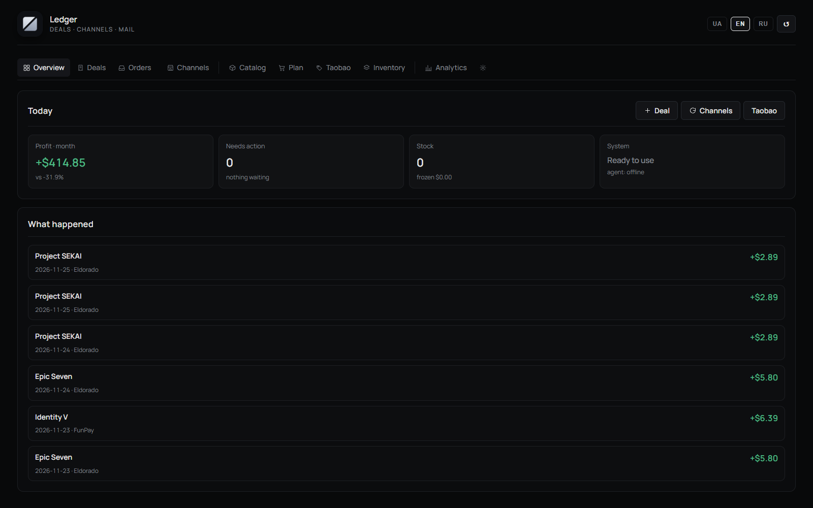
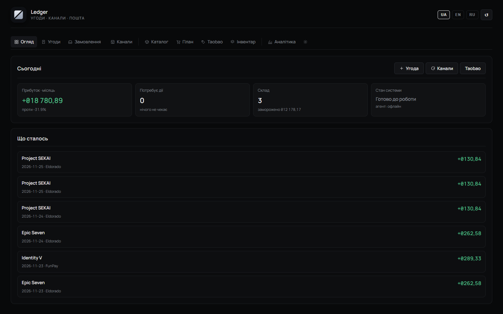
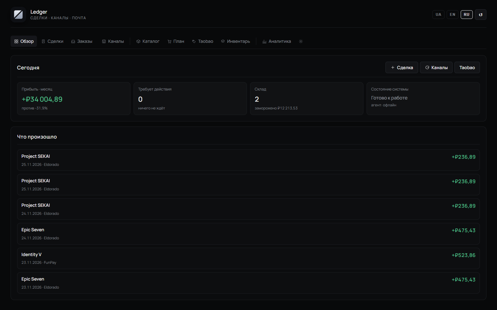
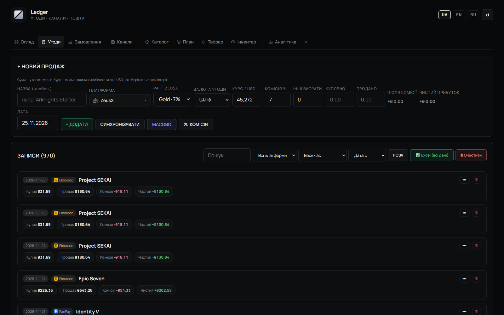
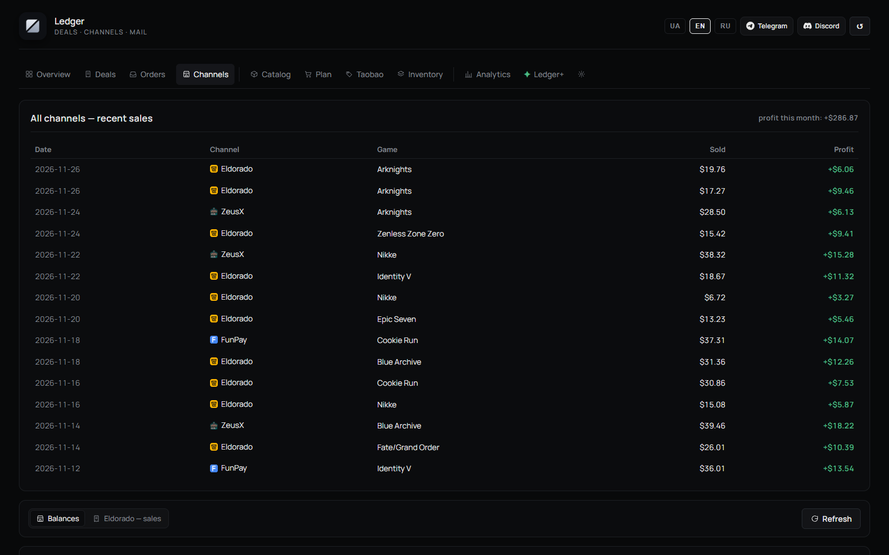
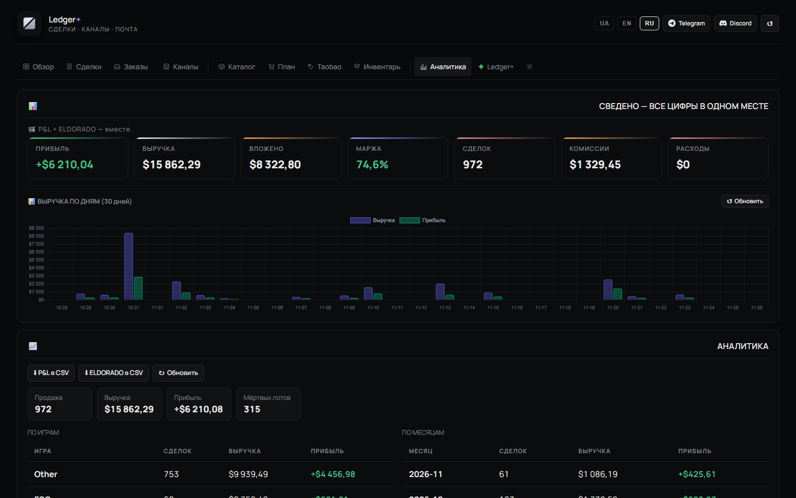

# Ledger

**Bookkeeping for game-account resale** — deals, stock, sales channels, mailbox orders, catalog, analytics and backups in one dashboard. Runs locally with Python's standard library; no subscription and no mandatory tokens.

[Українська версія](README.uk.md)



---

## Two editions

| | **Ledger** | **Ledger+** |
|---|---|---|
| Who it is for | Anyone who wants a private, self-hosted ledger | Sellers who want the same ledger **hosted and automated** |
| Where it runs | Your PC or your own server | Managed server, always online |
| Price | Free, MIT | Paid subscription |
| Desktop app | `Ledger.exe` — portable, data next to the exe | `LedgerPlus.exe` — native window, tray and order notifications |
| Automation | Manual mode; optional FunPay/ZeusX/Taobao connectors | Taobao collection, automatic order import, backup/restore, team seats, monitoring |
| Data | Yours, on your disk | Hosted for you; the desktop app and browser share the same account |

The free edition is in this repository. Ledger+ is the hosted automation edition — [contact the author](https://github.com/voidwhisperr) for access.

### Ledger+ and pricing

- **Solo** — $7/month: hosted instance, Taobao agent, automatic order import, backups, updates.
- **Team** — $29/month: the same plus team seats (owner / manager / viewer) via one-time invite links.
- **Done-for-you setup** — $29 one-time: installation, Telegram bot, channels, Taobao, data import, training.
- **Trial** — 14 days; keys are one-device and activated online, with deactivate-to-move.

Pricing page: `/pricing?lang=uk|en|ru` on the hosted instance. Releases: [github.com/voidwhisperr/ledger/releases](https://github.com/voidwhisperr/ledger/releases/latest).

---

## Features

### Ledger (free)

- **Deals / P&L** — buy and sell prices, editable marketplace fee per deal, ZeusX seller tiers, net profit, search, filters, sorting, bulk rename, CSV and Excel export.
- **Inventory** — purchased accounts with cost, source, status, credentials revealed on demand, dead-stock warning and CSV exports.
- **Eldorado ledger** — a separate manual ledger with its own fee, categories, filters and CSV export.
- **Channels** — FunPay, ZeusX and Eldorado in one view, marketplace fee comparison, balances and recent sales.
- **Orders from mail** — Gmail IMAP orders are queued; move them to P&L or Eldorado in one click.
- **Analytics** — profit, revenue, invested capital, fees, margin, top games, monthly breakdown, 30-day chart and a monthly report.
- **Catalog** — supplier products from Shopify `/products.json`, price history, "cheaper elsewhere" comparison and a lot price calculator.
- **Buy plan** — compares supplier prices with your own median sale price and ranks lots by ROI.
- **Backups** — automatic snapshots, manual runs, ZIP export/import, optional cloud-folder copy and restore.
- **Token check** — FunPay, ZeusX, Gmail and Telegram are validated live: active, expired, not set or check failed.
- **3 languages** — Ukrainian, English, Russian. Currency follows the language: ₴, $, ₽. 5 themes. Responsive layout.

### Ledger+ (hosted)

Everything in Ledger, plus:

- Taobao collection with a browser agent and captcha hand-off.
- Automatic order import and Telegram notifications.
- Scheduled supplier refreshes, price alerts and digest.
- Hosted 24/7 with HTTPS, password login and 2FA.
- `LedgerPlus.exe` — native desktop window connected to your hosted account, tray icon and Windows notifications.

---

## Screenshots

**Overview — three languages**

| Українська | English | Русский |
|---|---|---|
|  |  |  |

**Deals and balances**

| Deals (UA) | Channels (EN) | Analytics (RU) |
|---|---|---|
|  |  |  |

All screens: [English](docs/demo/en) · [Українська](docs/demo/uk) · [Русский](docs/demo/ru).

---

## Desktop apps

### Ledger.exe (free)

Portable Windows app: a native WebView2 window with the embedded server, no browser tab and no PWA installation.

- Data and backups are stored next to the exe.
- If a Ledger server is already running on `127.0.0.1:8766` (for example the browser version), the app attaches to it, so both see the same records.
- To use a remote server instead, create `client.json` next to the exe:

```json
{ "server": "https://your-ledger.example" }
```

Download: [Releases](https://github.com/voidwhisperr/ledger/releases/latest).

### LedgerPlus.exe (hosted edition)

Connected to your Ledger+ account: the window opens the hosted app directly, the tray keeps it running, and new orders arrive as Windows notifications. Configuration lives in `client.json` next to the exe; the password can be stored DPAPI-encrypted.

---

## Quick start (Windows)

1. Install **Python 3.11 or newer** from [python.org](https://www.python.org/downloads/). Enable **"Add python.exe to PATH"**.
2. Download or clone this repository and extract it anywhere.
3. Double-click **`start.bat`**.
4. Open **http://127.0.0.1:8766**.

The first launch asks for language and currency. A shortcut with the app icon is created next to `start.bat`.

### Manual start

```bash
python game_tracker.py
```

No `pip install` is needed for the main app. Data is stored next to it in `.gt_*.json` files. Set `PORT` if 8766 is busy.

---

## Docker

```bash
docker compose up -d
```

Open http://localhost:8766. Data lives in the named volume `ledger_data` (mounted at `/app/data`).

---

## Server / VPS

```bash
GT_BIND=0.0.0.0 GT_AUTH=basic GT_AUTH_PASS='a-long-password' python game_tracker.py
```

- Set a password before exposing the app.
- Prefer `GT_BIND=127.0.0.1` behind a reverse proxy with HTTPS.
- Keep `.gt_secrets.json`, `.env` and `client.json` out of version control.

---

## First run

1. Choose the interface language and currency.
2. Optionally set a password in **⚙ → Password**.
3. Add a deal or an inventory item — or load demo data in **⚙ → Data & diagnostics**.
4. Configure channels, mail or suppliers only if you need them.

---

## Build, licences and residual risks

- Windows release builds are reproducible: [scripts/build_release.ps1](scripts/build_release.ps1) builds `Ledger.exe` and `LedgerPlus.exe` from the pinned environment in [scripts/build-requirements.txt](scripts/build-requirements.txt) (Python 3.14.2, PyInstaller 6.22.3), excludes PyQt5/PySide6/Qt, and emits `SHA256SUMS.txt` + `BUILD-INFO.txt`.
- Third-party components, versions and licences: [THIRD-PARTY-NOTICES.md](THIRD-PARTY-NOTICES.md). PyQt5/Qt were removed in v1.66.42; older exes still contain them, so rebuild instead of redistributing those.
- Chart.js 4.4.1 and SheetJS 0.18.5 are loaded from cdnjs with pinned SHA-384 SRI; the Manrope font comes from Google Fonts.
- Known limitations are listed in [docs/DEPLOY.md](docs/DEPLOY.md#residual-build-risks): runtime CDN dependency, build pins versions but not hashes, PyInstaller onefile extraction, self-signed code-signing certificate, and the end-of-life SheetJS 0.18.5 write-only usage.
- v1.66.42 release notes: [English](docs/update-16642-en.md) · [Українська](docs/update-16642-ua.md) · [Русский](docs/update-16642-ru.md).

## Tech

Python 3.11+ standard library, a single-file HTML/JS dashboard, JSON storage, optional `cryptography` for encrypted backups. MIT licensed.
