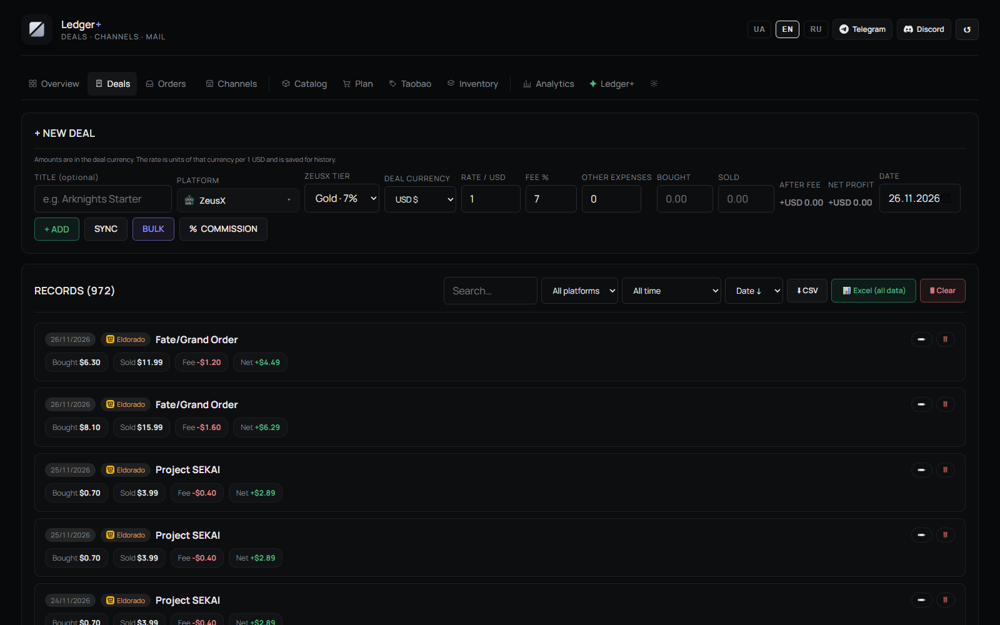
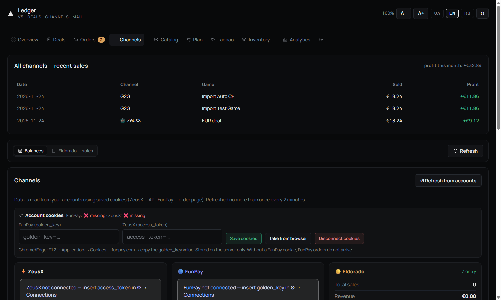
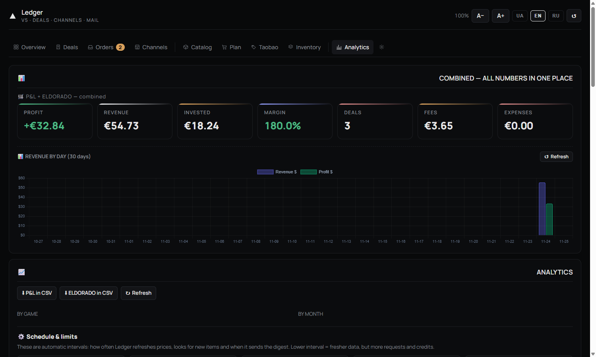
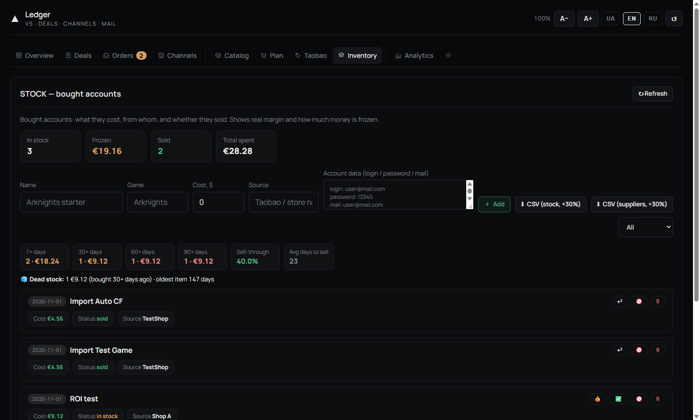

# AccTrack

**A self-hosted bookkeeping tracker for game-account resellers** — deals, inventory, sales channels, mailbox orders, analytics, and backups in one dashboard.

Runs locally with Python's standard library. No tokens are required: every core feature works in manual mode. Optional integrations (FunPay, ZeusX, Gmail, Telegram, Shopify catalog, Taobao) are configured with your own credentials.

[Українська версія](README.uk.md)


---

## Features

### Core (works without any tokens)

- **Deals / P&L** — buy and sell prices, **editable marketplace fee per deal** (including a custom % for “Other”, and ZeusX seller tiers), net profit, search, filters, sorting, bulk rename, CSV and Excel export.
- **Inventory** — purchased accounts with cost, source, status (in stock / sold / written off), account credentials (revealed only on demand), dead-stock warning, and CSV exports.
- **Eldorado ledger** — separate manual ledger with its own fee, categories, filters, and CSV export.
- **Channels** — FunPay, ZeusX, and Eldorado in one view; marketplace fee comparison calculator; balances and recent sales.
- **Orders from mail** — Gmail IMAP orders are queued; move them to P&L or Eldorado with one click, ignore or delete them, and keep a clean queue.
- **Analytics** — profit, revenue, invested capital, fees, margin, top games, monthly breakdown, 30-day chart, month-over-month comparison, and a monthly report with CSV export.
- **Catalog** — supplier products from Shopify `/products.json`, price history, "cheaper elsewhere" comparison, and a lot price calculator.
- **Buy plan** — compares supplier prices with the median of your own sales for similar lots and ranks the best options by ROI.
- **Backups** — automatic snapshots before writes, manual backup runs, ZIP export/import, optional cloud-folder copy, and restore for supported snapshots.
- **Diagnostics** — version, uptime, record counts, file sizes, and token status.

### UI

- **3 languages**: Ukrainian, English, Russian.
- **5 themes**: Ledger, Slate, Nord, Carbon, Light.
- **Responsive layout** for desktop and mobile.
- Optional password login, HTTPS certificate fields, and Cloudflare Access support.
- PWA manifest and icon.

### Optional integrations

| Integration | What you need | Notes |
|---|---|---|
| **FunPay** | `golden_key` cookie | Balances and orders; cookie expires periodically |
| **ZeusX** | `access_token` cookie | API-based balances and offers |
| **Eldorado** | — | No public API; use manual entry or mail |
| **Gmail** | Gmail address + App Password | Requires IMAP; orders are recognized automatically |
| **Telegram** | Bot token + chat ID | Notifications and bot commands |
| **Shopify suppliers** | Store URL | Reads public `/products.json` |
| **Taobao** | Optional Playwright collector + browser | Manual lots work without the collector |

---

## Screenshots

| Deals | Channels |
|---|---|
|  |  |

| Analytics | Inventory |
|---|---|
|  |  |

More screens in [docs/demo/en](docs/demo/en).

---

## Quick start (Windows)

1. Install **Python 3.11 or newer** from [python.org](https://www.python.org/downloads/). During installation, enable **"Add python.exe to PATH"**.
2. Download or clone this repository and extract it to any folder.
3. Double-click **`start.bat`**.
4. Open **http://127.0.0.1:8766** in your browser.

> In PowerShell, run `.start.bat` (or `cmd /c start.bat`).

The first launch shows a language picker, then the dashboard. A shortcut with the app icon is created next to `start.bat` on first run.

### Manual start (any OS)

```bash
python game_tracker.py
```

Then open http://127.0.0.1:8766.

- Python 3.11+ is recommended.
- No `pip install` is required for the main app.
- Data is stored next to the app in `.gt_*.json` files.
- If the port is busy, set `PORT` (or `GT_PORT`) to another value.

---

## Docker

```bash
docker compose up -d
```

Open http://localhost:8766. Data is stored in the named volume `acctrack_data` (mounted at `/app/data`).

To use a different port:

```yaml
ports:
  - "9000:8766"
```

---

## Server / VPS

For 24/7 use, run the app behind a reverse proxy with HTTPS (Caddy, nginx, or Cloudflare Tunnel).

```bash
GT_BIND=0.0.0.0 GT_AUTH=basic GT_AUTH_PASS='a-long-password' python game_tracker.py
```

Recommendations:

- Set a password before exposing the app.
- Prefer `GT_BIND=127.0.0.1` behind a local reverse proxy.
- Keep `.gt_secrets.json`, `.env`, and `config.json` out of version control.
- Do not expose the app publicly without authentication.

---

## First run

1. Choose the interface language.
2. Optionally set a password in **⚙ → Password**.
3. Add your first deal, inventory item, or load demo data in **⚙ → Data & diagnostics**.
4. Configure channels, mail, or suppliers only if you need them.

The app starts in **manual mode** and remains fully usable without any external accounts.

---

## Configuration

Copy `.env.example` to `.env` only if you start the app through a process manager that loads it. The app itself reads environment variables directly.

| Variable | Default | Purpose |
|---|---|---|
| `PORT` / `GT_PORT` | `8766` | HTTP port |
| `GT_BIND` | `127.0.0.1` | Bind address |
| `GT_AUTH` | auto | `off`, `basic`, or `cloudflare` |
| `GT_AUTH_USER` | `admin` | Login user |
| `GT_AUTH_PASS` | generated warning | Login password |
| `GT_REQUIRE_ACCESS` | — | Require Cloudflare Access header |
| `GT_COLLECTOR_TOKEN` | — | Token for the Taobao collector |
| `GT_DATA_DIR` | app folder | Where `.gt_*.json` data lives |
| `GT_NO_SUPPLIERS` | — | Disable network supplier refresh |
| `GT_NO_BROWSER` | — | Do not open a browser on start |

Secrets are stored in `.gt_secrets.json` and are **not** included in backups.

---

## Data and backups

- Main data: `.gt_pl.json`, `.gt_eldorado.json`, `.gt_inventory.json`, `.gt_settings.json`, `.gt_mail_queue.json`, `.gt_taobao.json`.
- Secrets: `.gt_secrets.json` (cookies, Gmail App Password, login password).
- Automatic snapshots: `gt_backups/`.
- Backup ZIP: **⚙ → Export all data**.
- Cloud copy: optional folder in **⚙ → Cloud backup**.

Restore and import create a safety copy before replacing data.

---

## Tests

```bash
# Isolated end-to-end test (starts its own copy on port 8799)
python tests/local_test.py

# API smoke test against a running app
python tests/api_smoke.py

# Auth flow test (isolated copy)
python tests/verify_auth.py

# UI smoke test (requires Playwright and Chrome with CDP on port 9222)
python tests/ui_smoke.py
```

`local_test.py` is the safest first check: it does not touch your real data.

---

## Project structure

```text
game_tracker.py      HTTP server, data model, mail/Telegram, backups
ui.py                Embedded HTML/CSS/JS dashboard
platforms.py         FunPay / ZeusX / Eldorado connectors
taobao.py            Taobao data helpers
taobao_core.py       Taobao core utilities
taobao_collector.py  Optional Playwright collector agent
docs/                Screenshots and guides
tests/               End-to-end and smoke tests
start.bat            Windows launcher
run.bat              Minimal launcher
docker-compose.yml   Docker setup
```

---

## Optional Taobao collector

The main app works without the collector. To use live Taobao collection:

1. Install Playwright and a Chromium browser.
2. Copy `config.json.example` to `config.json` and set `server` and `token`, or set `GT_SERVER` and `GT_TOKEN`.
3. Start a debug browser with CDP on port `9222`.
4. Run:

```bash
python taobao_collector.py
# or a single run:
python taobao_collector.py --once
```

On Windows you can use **`launchers/taobao_agent.bat`** instead.

Taobao may block automated access; manual lots and manual marks remain available.

---

## Troubleshooting

**"Python not found"** — install Python 3.11+ and enable "Add python.exe to PATH", then reopen the terminal.

**Port already in use** — stop the other process or set `PORT=8767` before starting.

**Page does not load** — open http://127.0.0.1:8766, not the file path. The app is a local web server.

**Forgot password** — stop the app, set `"auth_enabled": false` in `.gt_settings.json` (and remove `auth_pass` from `.gt_secrets.json` if present), then start again. Set a new password in Settings.

**Charts or Excel export fail** — Chart.js and SheetJS are loaded from cdnjs; check your internet connection or allow cdnjs.

**No mail orders** — Gmail requires IMAP and an App Password. Check **⚙ → Gmail**.

---

## Security notes

- Default bind is `127.0.0.1`, so only this computer can connect.
- Set a strong password before exposing the app to a network.
- CSRF protection is enabled for state-changing requests.
- Secrets are stored locally and are excluded from backups.
- The app is not affiliated with FunPay, ZeusX, Eldorado, Taobao, Gmail, Telegram, or any marketplace. Follow their terms of service.

---

## License

MIT — see [LICENSE](LICENSE).

---

## Languages

- [English](README.md)
- [Українська](README.uk.md)
