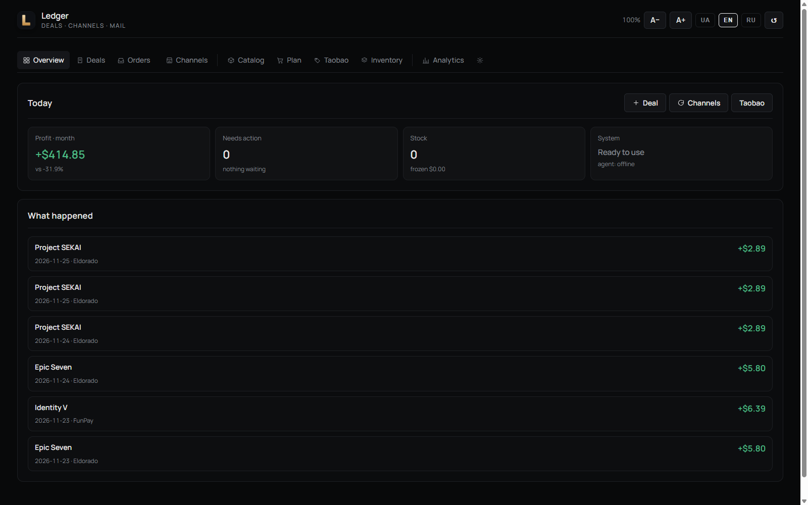
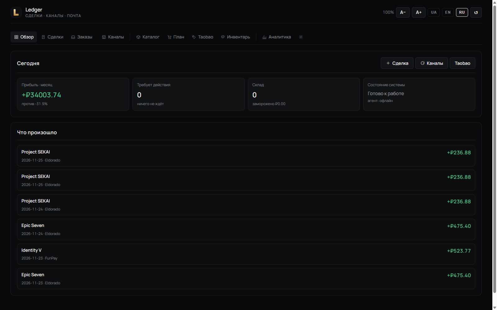
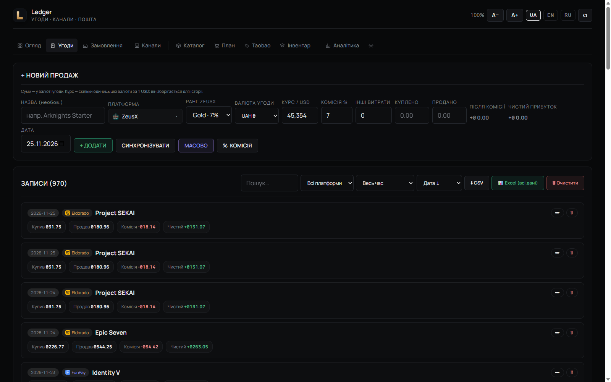
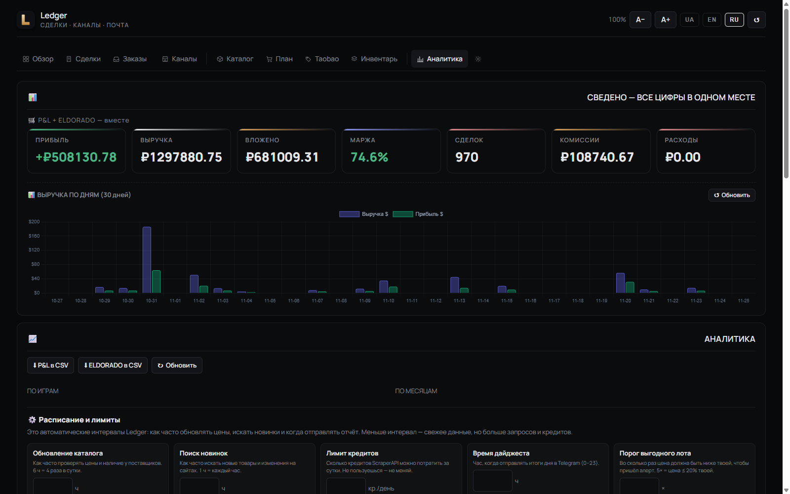

# Ledger

**Облік продажів ігрових акаунтів** — угоди, склад, канали, замовлення з пошти, каталог, аналітика та бекапи в одному вікні. Працює локально на стандартній бібліотеці Python; без підписки й без обов'язкових токенів.

[English version](README.md)


---

## Дві версії

| | **Ledger** | **Ledger+** |
|---|---|---|
| Для кого | Приватний облік на власному ПК чи сервері | Ті самі облікові дані, але **на хостингу з автоматизацією** |
| Де працює | Ваш ПК або ваш сервер | Керований сервер, онлайн 24/7 |
| Ціна | Безкоштовно, MIT | Платна підписка |
| Додаток | `Ledger.exe` — портативний, дані поруч з exe | `LedgerPlus.exe` — нативне вікно, трей і сповіщення |
| Автоматизація | Ручний режим; опційні конектори FunPay/ZeusX/Taobao | Збір Taobao, імпорт замовлень, сповіщення, бекапи — налаштовано й обслуговується |
| Дані | Ваші, на вашому диску | На хостингу; додаток і браузер працюють з одним акаунтом |

Безкоштовна версія — у цьому репозиторії. Ledger+ — хостингова версія з автоматизацією; доступ за запитом до автора.

---

## Можливості

### Ledger (безкоштовно)

- **Угоди / P&L** — ціна купівлі й продажу, комісія на кожну угоду, ранги ZeusX, чистий прибуток, пошук, фільтри, сортування, масове перейменування, CSV та Excel.
- **Інвентар** — куплені акаунти: собівартість, джерело, статус, дані акаунта на вимогу, попередження про мертвий склад, CSV.
- **Eldorado** — окремий ручний облік зі своєю комісією, категоріями, фільтрами й CSV.
- **Канали** — FunPay, ZeusX та Eldorado в одному вікні, порівняння комісій, баланси й останні продажі.
- **Замовлення з пошти** — Gmail IMAP; перенос у P&L або Eldorado одним кліком.
- **Аналітика** — прибуток, виручка, вкладений капітал, комісії, маржа, топ ігор, розбивка по місяцях, графік 30 днів і місячний звіт.
- **Каталог** — товари постачальників із Shopify `/products.json`, історія цін, порівняння «дешевше в інших», калькулятор лота.
- **План закупівель** — порівнює ціни постачальників із вашою медіаною продажу й ранжує лоти за ROI.
- **Бекапи** — автоматичні снапшоти, ручний запуск, ZIP-експорт/імпорт, копія в хмарну папку, відновлення.
- **3 мови** — українська, англійська, російська. Валюта йде за мовою: ₴, $, ₽. 5 тем. Адаптивний інтерфейс.

### Ledger+ (хостинг)

Усе з Ledger, плюс:

- Збір Taobao через браузерного агента й передача капчі.
- Автоматичний імпорт замовлень і сповіщення в Telegram.
- Оновлення постачальників за розкладом, алерти цін і дайджест.
- Хостинг 24/7 з HTTPS, паролем і 2FA.
- `LedgerPlus.exe` — нативне вікно до вашого хостингу, трей і сповіщення Windows.

---

## Скріншоти

| Українська | English | Русский |
|---|---|---|
|  |  |  |

| Угоди (UA) | Канали (EN) | Аналітика (RU) |
|---|---|---|
|  |  |  |

Усі екрани: [Українська](docs/demo/uk) · [English](docs/demo/en) · [Русский](docs/demo/ru).

---

## Додатки

### Ledger.exe

Портативний Windows-додаток: нативне вікно WebView2 з вбудованим сервером, без вкладок браузера й без встановлення PWA.

- Дані й бекапи зберігаються поруч з exe.
- Якщо на `127.0.0.1:8766` уже працює Ledger (наприклад, браузерна версія), додаток підключається до нього — обидва бачать одні й ті самі записи.
- Щоб підключитися до віддаленого сервера, створіть `client.json` поруч з exe:

```json
{ "server": "https://your-ledger.example" }
```

Завантажити: [Releases](https://github.com/voidwhisperr/ledger/releases/latest).

### LedgerPlus.exe

Підключається до вашого акаунта Ledger+: вікно відкриває хостинговий застосунок напряму, трей тримає його запущеним, нові замовлення приходять сповіщеннями Windows. Налаштування — у `client.json` поруч з exe; пароль можна зберегти через DPAPI.

---

## Швидкий старт (Windows)

1. Встановіть **Python 3.11+** з [python.org](https://www.python.org/downloads/), позначивши **"Add python.exe to PATH"**.
2. Завантажте репозиторій і розпакуйте в будь-яку папку.
3. Запустіть **`start.bat`**.
4. Відкрийте **http://127.0.0.1:8766**.

Перший запуск запитає мову й валюту. Ярлик з іконкою створюється поруч зі `start.bat`.

### Ручний запуск

```bash
python game_tracker.py
```

`pip install` для основного застосунку не потрібен. Дані — у `.gt_*.json` поруч. Якщо 8766 зайнятий, задайте `PORT`.

---

## Docker

```bash
docker compose up -d
```

http://localhost:8766. Дані — у томі `ledger_data` (`/app/data`).

---

## Сервер / VPS

```bash
GT_BIND=0.0.0.0 GT_AUTH=basic GT_AUTH_PASS='довгий-пароль' python game_tracker.py
```

- Перед публікацією в інтернет обов'язково поставте пароль.
- Краще `GT_BIND=127.0.0.1` за реверс-проксі з HTTPS.
- Не комітьте `.gt_secrets.json`, `.env` і `client.json`.

---

## Перший запуск

1. Оберіть мову й валюту.
2. За потреби поставте пароль у **⚙ → Пароль**.
3. Додайте угоду або позицію складу — чи завантажте демо-дані в **⚙ → Дані й діагностика**.
4. Канали, пошту й постачальників налаштовуйте лише за потреби.

---

## Технології

Python 3.11+, стандартна бібліотека, односторінковий HTML/JS-дашборд, JSON-сховище, опційно `cryptography` для шифрованих бекапів. Ліцензія MIT.
