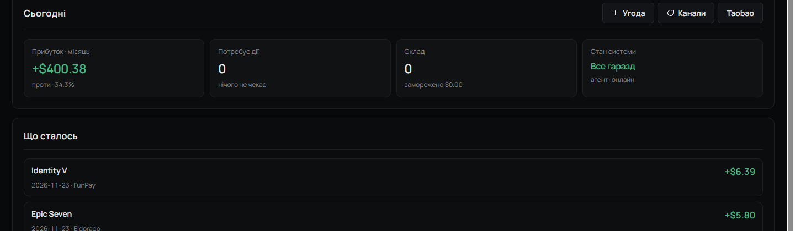
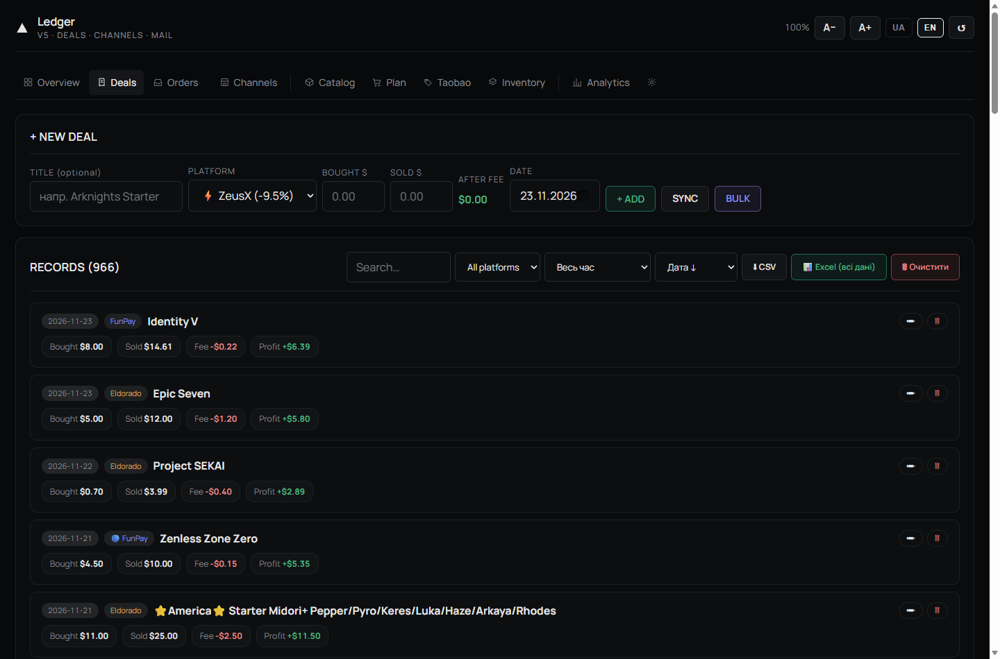
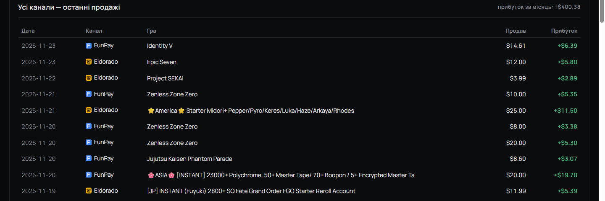

# AccTrack — облік продажів ігрових акаунтів

[English README](README.md) · Українська

**AccTrack** — трекер для перепродавців ігрових акаунтів: угоди, склад, канали, аналітика, бекапи.
Працює **повністю вручну** (без жодних токенів) або з **вашими власними** токенами FunPay / ZeusX.

> Публічна версія. Даних, постачальників і контактів автора тут немає.



## Можливості

- **Облік угод** — купівля/продаж, **комісія майданчика на кожну угоду** (у тому числі свій % для «Інше»), чистий прибуток, експорт CSV/Excel.
- **Склад** — куплені акаунти, статуси (на складі / продано / списано), дані акаунта, «мертвий» склад.
- **Канали** — Eldorado (вручну/пошта), FunPay (`golden_key`), ZeusX (`access_token`) в одному місці.
- **Замовлення з пошти** — Gmail IMAP → черга → один клік у P&L.
- **Аналітика** — прибуток по місяцях, топ ігор, маржа.
- **Бекапи** — знімок перед кожним записом, експорт у zip, хмарний бекап.
- **3 мови** (UA / EN / RU) і **5 тем** оформлення.

## Що працює, а що ні

Детальна матриця: **[docs/FEATURES.md](docs/FEATURES.md)** — які функції працюють
без токенів, які вимагають cookie/API, і чому дещо недоступно.

Коротко: угоди, склад, аналітика, бекапи, імпорт/експорт — **працюють завжди**.
Канали FunPay/ZeusX — з вашими токенами. Taobao — окремий агент.

## Швидкий старт

### Варіант A — ПК (Windows)

Двічі клікніть **`start.bat`** — у консолі з'явиться логотип, далі `http://127.0.0.1:8766`

> У **PowerShell** потрібно `.\start.bat` (або `cmd /c start.bat`) — 
> PowerShell не запускає файли з поточної папки без `.\`.
(без пароля; пароль вмикається в `⚙ → PASSWORD`).

**Ярлик з іконкою** створюється автоматично при першому запуску `start.bat` —
поряд з'явиться `AccTrack.lnk` з трикутником ▲ (можна винести на робочий стіл).
Окремо: `make-shortcut.bat` — створити ярлик заново.

Для постійної роботи — автозапуск (докладно в `docs/SETUP.md`).

### Варіант A+ — Docker

```bash
docker compose up -d      # → http://localhost:8766
```

### Варіант B — сервер (24/7)

VPS 1 vCPU / 1 GB ≈ $5/міс + systemd + Caddy (TLS). Інструкція в `docs/SETUP.md`.

> **Чесно:** для постійної роботи потрібен або ввімкнений ПК, або сервер.
> На ПК застосунок працює, лише коли компʼютер увімкнений.

## Скріншоти

| Угоди | Канали |
|---|---|
|  |  |

## Підключення каналів (опційно)

| Канал | Що потрібно | Де взяти |
|---|---|---|
| **FunPay** | cookie `golden_key` | F12 → Application → Cookies → `funpay.com` |
| **ZeusX** | `access_token` | F12 → Network → запит до `api.zeusx.com` → заголовок `Authorization: Bearer …` |
| **Eldorado** | публічного API немає | вручну або з листів пошти |

Без токенів усе працює вручну — це нормальний режим, а не «обмежена версія».

## Постачальники

Список постачальників порожній. Додайте свої Shopify-магазини:
`⚙ → Постачальники` або впишіть у `SUPPLIERS` у `game_tracker.py`.

## Ліцензія

MIT — див. `LICENSE`.

## Автоматизація

Потрібен збір Taobao, авто-імпорт FunPay/ZeusX, проходження капчі — напишіть:

- **Telegram:** [@ENOUGHT285](https://t.me/ENOUGHT285)
- **Email:** dhdueu564@gmail.com
- **Discord:** `facemyfear`
