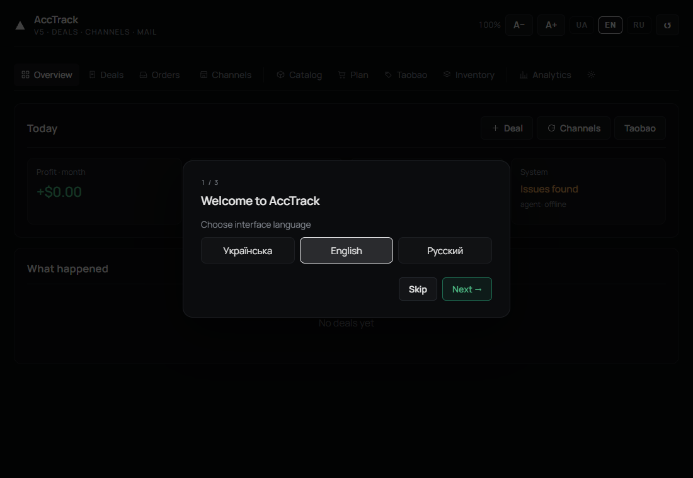
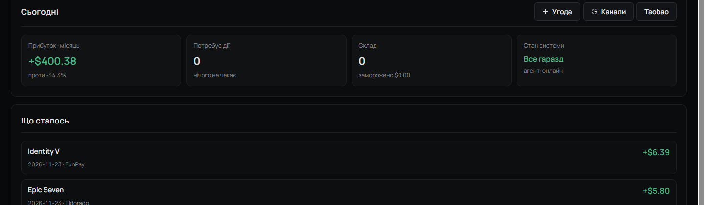
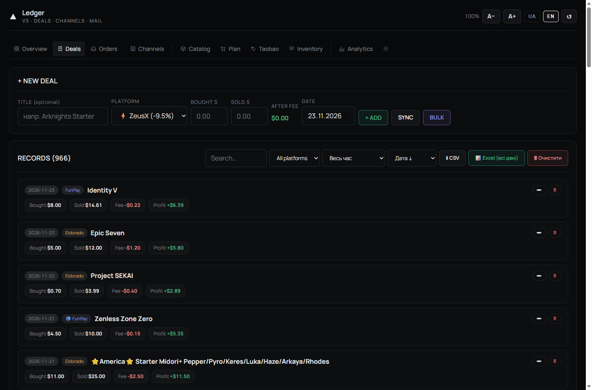
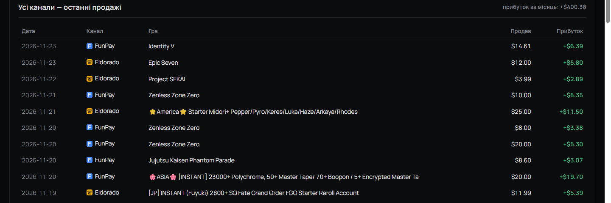
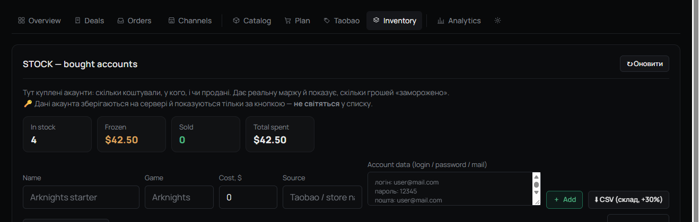
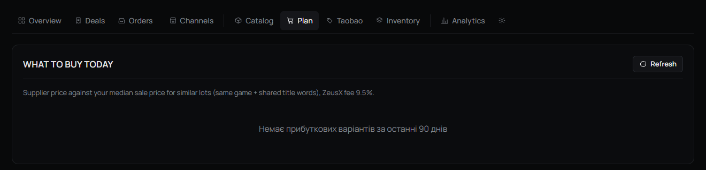
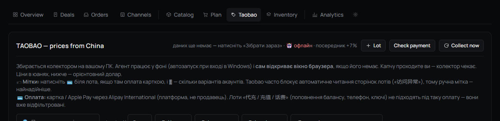

# Туторіал AccTrack

Покроково: від першого запуску до повного обліку.
Скріншоти — з робочого застосунку (дані демонстраційні).

---

## 1. Перший запуск

Після старту застосунку відкрийте `http://127.0.0.1:8766` і введіть пароль.
Пароль генерується автоматично при першому запуску — він лежить у `.gt_secrets.json`.

Далі з'явиться **онбординг із 3 кроків**:



| Крок | Що робить |
|---|---|
| **1 / 3** | вибір мови: Українська / English / Русский |
| **2 / 3** | назва застосунку (можна лишити AccTrack) + тема оформлення |
| **3 / 3** | вставити токени FunPay / ZeusX — **або натиснути Skip** і працювати вручну |

**Skip — це нормальний шлях.** Без токенів доступні угоди, склад, аналітика, бекапи.

---

## 2. Головний екран — Огляд



Чотири плитки відповідають на головні питання:

- **Прибуток · місяць** — чистий прибуток (після комісій і закупівлі) + порівняння з минулим місяцем;
- **Потребує дії** — скільки замовлень чекає в черзі;
- **Склад** — скільки акаунтів лежить і на яку суму «заморожено»;
- **Стан системи** — агент збору та канали онлайн.

Нижче — стрічка «Що сталось»: останні продажі з **усіх** каналів разом (FunPay, Eldorado, ZeusX).

---

## 3. Угоди (P&L)



- Форма **+ Новий продаж**: назва, платформа, купив, продав, дата.
  Платформа вибирається з логотипами й одразу показує комісію (−9.5% ZeusX, −1.5% FunPay, −10% Eldorado).
- **Записи** — усі угоди; Eldorado-продажі підтягуються в цей самий список.
- Фільтри: пошук, платформа, період, сортування.
- Експорт: **CSV** і **Excel (всі дані)**.

Прибуток рахується завжди як `продав − комісія − купив`.

---

## 4. Канали — три майданчики в одному місці



Верхня таблиця — **спільний список продажів усіх каналів** з логотипами.
Нижче — картки каналів:

| Канал | Що показує | Звідки дані |
|---|---|---|
| **ZeusX** | акаунт, баланс, в обробці, виведено, тір, замовлення | API з вашим `access_token` |
| **FunPay** | останні 30 замовлень, нові повідомлення | сторінка кабінету з cookie `golden_key` |
| **Eldorado** | продажів усього, виторг, прибуток, місяць | вручну або з листів пошти |

Перемикач **Баланси / Eldorado — продажі** всередині вкладки.

---

## 5. Підключення токенів

Блок **Cookie кабінетів** (у Каналах) — три поля:
`FunPay (golden_key)`, `ZeusX (access_token)`, кнопка «Взяти з браузера» (якщо у вас є агент).


Де взяти токени:

- **FunPay:** F12 → Application → Cookies → `funpay.com` → `golden_key`
- **ZeusX:** F12 → Network → будь-який запит до `api.zeusx.com` → `Authorization: Bearer <token>`
- **Eldorado:** публічного API немає — облік вручну

---

## 6. Склад

- Додаєте куплений акаунт: назва, гра, собівартість, джерело, дані акаунта.
- Статуси: **на складі / продано / списано**.
- «Мертвий склад» показує, скільки грошей заморожено в акаунтах, що лежать 30+ днів.

---

## 7. Пошта → замовлення

`⚙ → Gmail` → вказуєте адресу й App Password (Google → Security → App passwords).
Трекер читає листи й складає замовлення в **Замовлення**. Далі один клік → у P&L.

---

## 8. Бекапи

- Знімок даних робиться **перед кожним записом** (файли в `gt_backups/`).
- `⚙ → Експорт усіх даних` — повний zip.
- Хмарний бекап — опційно (папка синхронізації).

---

---

## 10. Склад (демо-скрін)



- **In stock / Frozen / Sold / Total spent** — скільки акаунтів лежить і на яку суму.
- «Мертвий склад» — позиції, куплені 30+ днів тому.
- Дані акаунта (логін/пароль) показуються **тільки за кнопкою**, у списку не світяться.

## 11. План «що купити»



Порівнює ціну постачальника з **медіаною ваших продажів** по схожих лотах.
Порожній, якщо немає історії продажів або каталогу — це нормально.

## 12. Taobao



Панель є, але збір лотів потребує **окремого агента** (Playwright + браузер на вашому ПК):
Taobao блокує серверні IP і показує капчу. Без агента — кнопки не дадуть даних.
Деталі: [FEATURES.md](FEATURES.md).

## 13. Імпорт з Excel/CSV

`⚙ → Дані й діагностика → Імпорт CSV`

```csv
date,title,platform,buy,sell
2026-11-20,Arknights,FunPay,5,12
21.11.2026,Zenless,ZeusX,8,20
```

- Дати: `2026-11-20`, `21.11.2026`, `21/11/2026`
- Платформи: `FunPay`, `ZeusX`, `Eldorado`, будь-що інше → «Інше»
- Коми в цінах (`12,50`) і `$` — розпізнаються
- Некоректні рядки пропускаються з поясненням

## 14. Docker

```bash
docker compose up -d      # → http://localhost:8766
```

Дані — у томі `acctrack_data`, переживають перезапуск контейнера.

## 15. Що працює, а що ні

Повна матриця функцій: **[FEATURES.md](FEATURES.md)**.
Коротко: облік, склад, аналітика, бекапи, імпорт/експорт — **завжди**;
канали — з токенами; Taobao — окремий агент.

## 9. Повна автоматизація

Цей репозиторій — **ручний/напівавтоматичний** варіант.
Повна автоматизація (збір Taobao з капчею, авто-імпорт FunPay/ZeusX, постійний агент на ПК)
— Telegram **@ENOUGHT285** · email **dhdueu564@gmail.com** · Discord **facemyfear**.
